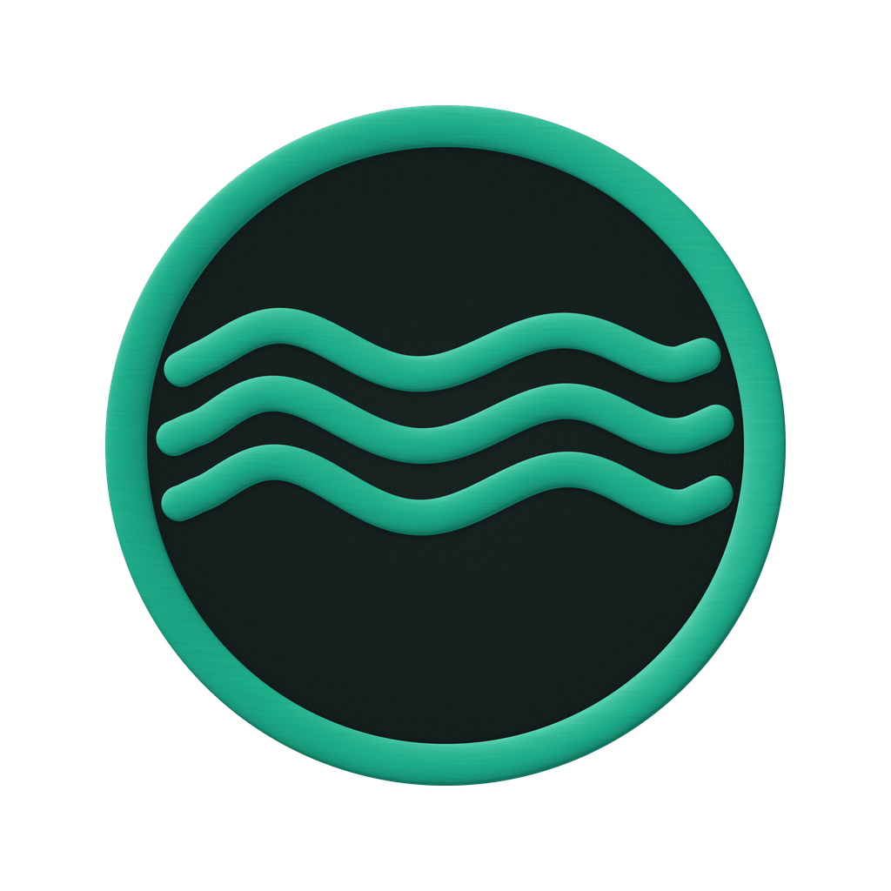

<!-- markdownlint-disable MD001 MD013 MD033 MD041 MD060 -->

<div align="center">



# Anclora Nexus

### Internal operational coordination system for documents and contracts

Centralized platform for managing operation folders, documents, templates, and signature workflows in real-estate transactions.

[Español](./README.md) · [Català](./README.ca.md) · **English** · [Deutsch](./README.de.md)

<br />


</div>

---

> [!IMPORTANT]
> Internal Anclora ecosystem repository. This tool coordinates critical operations with real transaction documents and data. Do not publish operational details, credentials, customer data, or sensitive logic outside authorized channels.

## What it is

Nexus is the central operational platform for handling documents and contracts across the real-estate transaction lifecycle. It coordinates operation folders, manages document templates, generates e-signature workflows (DocuSeal), integrates contract validation via Advisor AI, and provides oversight views for internal teams.

## Category in the ecosystem

| Field | Value |
|---|---|
| Category | Internal |
| Brand accent | `#D4AF37` |
| Typography | Inter |
| Canonical repository | `anclora-nexus` |

## Key features

- **Operation folder management:** create, list, and manage folders linked to deals, properties, and stakeholders (leads, sellers, companies, contacts)
- **Document lifecycle:** encrypted upload/download, document versioning, legal review, and policy-compliant retention management
- **Template library:** templates by document family, quality metadata, automatic generation and validation
- **Signature workflows:** DocuSeal integration, signature envelope tracking, immutability of signed copies
- **Contract validation:** Advisor AI integration for automatic clause and legal-risk review
- **Operational coordination:** indicators, action auditing, and consolidated views for teams

## Technology stack

| Area | Technology |
|---|---|
| Frontend | Next.js 16, React 19, TypeScript |
| Authentication | Anclora Identity (OIDC) |
| Database | Neon PostgreSQL Data API |
| Storage | Vercel Blob (private objects) |
| Styling | Tailwind CSS, Radix UI, shadcn |
| Testing | Vitest + React Testing Library |
| UI Components | Lucide React, Framer Motion |
| Documents | jsPDF, react-markdown, doc-viewer |

## Local setup

```bash
cd frontend
npm install
npm run dev
```

The server will be available at `http://localhost:3000`.

## Supported languages

The production product supports 4 languages: Español (default), Català, English, Deutsch (`INTERNAL_LOCALES`, `frontend/src/lib/anclora-language-toggle.ts`). This documentation is maintained in all 4 product languages.

## Documentation and governance

- Workflow specifications: [`docs/DMS_*.md`](./docs/)
- Brand and governance contracts: `docs/standards/`
- Anclora Vault (source of truth): `contracts/` and `docs/governance/`

---

<div align="center">

### Anclora Group

Internal use

</div>
